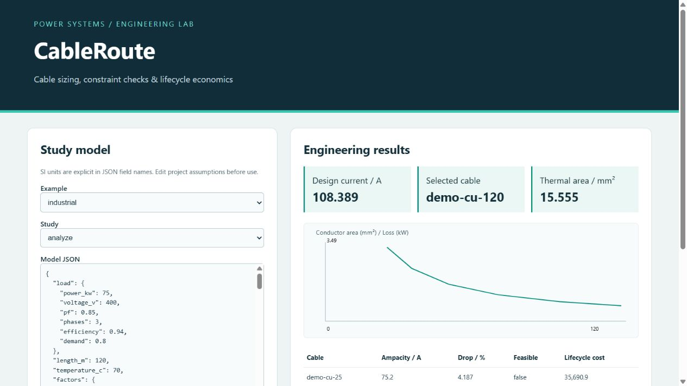

# CableRoute

Cable sizing and feeder design studio with explicit catalog provenance, constraint screening, and discounted loss economics.



## Run

```powershell
python -m pip install -e .
cableroute study example:industrial
cableroute serve --port 8770
python -m unittest discover -v
```

Open http://127.0.0.1:8770. Edit the JSON model, choose a study and run. Reports include the model, options and SHA-256 provenance. The service binds only to loopback. Python 3.11–3.13 and NumPy are supported. No frontend build or cloud service is required.

## Capabilities

Single/three-phase demand; temperature-dependent resistance; user-supplied ampacity ratings and correction factors; leading/lagging voltage drop; adiabatic short-circuit area; PE equivalence; harmonic neutral RMS; unequal complex parallel-path sharing; simultaneous feeder constraints; quantities; discounted lifecycle selection; installation-temperature sensitivity; JSON/print reports.

## Engineering scope

All bundled ampacity ratings and correction factors are explicitly SYNTHETIC demonstration values. Import verified project-specific data with source, edition, installation and material metadata. No normative tables are redistributed. Equal steady-state sharing is assumed by the feeder selector; the parallel_share API supports unequal impedances. Fault sharing is conservative unless explicitly enabled. Neutral/PE APIs are calculation aids, not a complete standards-rule engine. Protective breaking capacity, selectivity, disconnection times, earthing, installation approval and cable manufacturer limits require separate engineering checks. Adiabatic k must include its temperature/material basis.

## Validation

Seventy analytical fixtures cover ten engineering families, with individual derivations in [docs/references](docs/references). Additional tests exercise boundary conditions and integration. Expected results use closed-form identities, inverse constructions or conservation laws rather than copying solver output. References are educational data, not certified standard test systems. CI checks installation, all tests and installed CLI operation on three Python versions.

See [engineering conventions](docs/engineering.md), [API examples](docs/api.md), and [source notes](docs/sources.md). MIT license.
